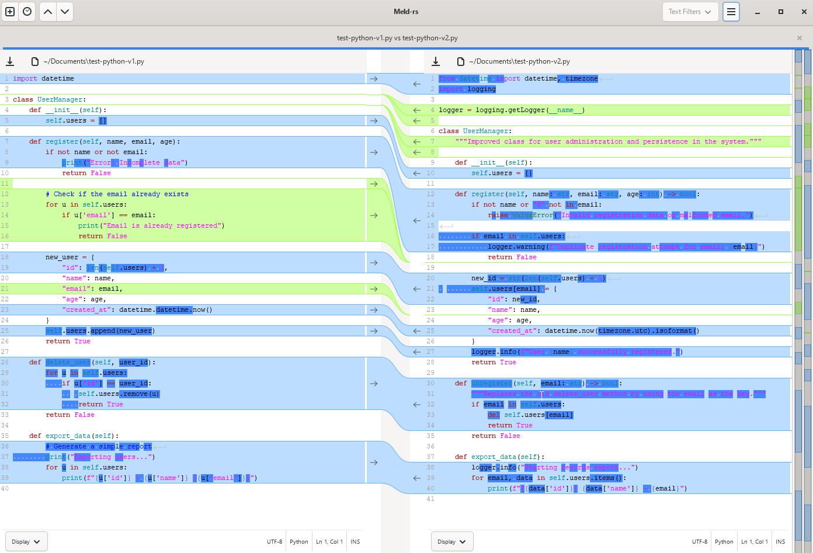

# Meld-rs

<div align="center">


</div>


**Meld-rs** is a complete rewrite of the [Meld](https://gitlab.gnome.org/GNOME/meld) visual diff
and merge tool in **Rust** using **gtk-rs** (GTK 4). It provides side-by-side file and directory
comparison, 3-way merge, and version control integration (Git, SVN, Mercurial).

> [!NOTE]
> Meld-rs is an independent community project inspired by Meld and written in
> Rust. It is not affiliated with, endorsed by, or maintained by the
> [GNOME Project](https://www.gnome.org/) or the upstream Meld maintainers.
> Meld-rs reuses Meld's GPL-licensed localization resources and gettext
> catalogs, allowing it to build upon the translation work contributed by the
> community.

> [!IMPORTANT]
> Meld-rs has matured past its early stage and is now stable enough to use with
> caution. It remains under active development, so expect the occasional rough
> edge, missing feature, or bug — it is not yet recommended as the sole tool for
> critical workflows.

## Features

- 2-way and 3-way file comparison with syntax highlighting
- Recursive directory comparison with filters
- 3-way merge with conflict resolution
- Version control integration (Git, SVN, Mercurial)
- Syntax highlighting via GtkSourceView
- Diff map sidebar for visual overview
- In-file search (find bar)
- Dark mode support
- Session management with multiple tabs
- UI available in 50 languages (reuses Meld's gettext catalogs)
- Command-line integration (`meld-rs <file1> <file2> [file3]`)

## Screenshots



## Download

Prebuilt Linux AppImages are attached to the
[GitHub releases](https://github.com/brandochn/meld-rs/releases) — built
automatically when a version tag is pushed. `scripts/build-appimage.sh` also
writes new ones into [`publish/`](publish/) when run locally.

The AppImage is self-contained: no installation is required, and because the
GTK 4 runtime is bundled you do not need any system packages.

```bash
chmod +x meld-rs-0.1.3-x86_64.AppImage
./meld-rs-0.1.3-x86_64.AppImage file_a.txt file_b.txt
```

## Requirements

- **Rust** 1.81 or later
- **GTK 4** runtime (4.16+ recommended)
- **GtkSourceView 5**
- **libadwaita**

### Platform-specific setup

**Linux (Debian/Ubuntu):**
```bash
sudo apt install libgtk-4-dev libgtksourceview-5-dev libadwaita-1-dev
```

**Linux (Fedora):**
```bash
sudo dnf install gtk4-devel gtksourceview5-devel libadwaita-devel
```

**Windows:**
Install GTK 4 via [MSYS2](https://www.msys2.org/):
```bash
pacman -S mingw-w64-x86_64-gtk4 mingw-w64-x86_64-gtksourceview5 mingw-w64-x86_64-libadwaita
```

**macOS:**
```bash
brew install gtk4 gtksourceview5 libadwaita
```

## Building

```bash
# Debug build
cargo build

# Release build
cargo build --release

# Or use the provided scripts
./scripts/build.sh        # Linux/macOS
./scripts/run.sh          # Linux/macOS (build & run)
scripts\build.ps1         # Windows (PowerShell, detects MSYS2)
scripts\build.bat         # Windows (CMD)
scripts\run.ps1           # Windows (PowerShell, build & run)
```

### Building an AppImage

`scripts/build-appimage.sh` builds the release binary, assembles an AppDir
(GTK 4 runtime libraries, GSettings schemas, icon, desktop entry and gettext
catalogs) with [linuxdeploy](https://github.com/linuxdeploy/linuxdeploy), and
writes the resulting AppImage into `publish/`:

```bash
./scripts/build-appimage.sh
# -> publish/meld-rs-0.1.3-x86_64.AppImage
```

It requires `cargo`, `patchelf`, `glib-compile-schemas` and `wget`;
`linuxdeploy` is downloaded automatically on first run.

### Releasing

Pushing a version tag that matches the `version` in `Cargo.toml` builds the
AppImage on GitHub Actions and attaches it to a GitHub release:

```bash
git tag v0.1.3
git push origin v0.1.3
```

The workflow lives in `.github/workflows/release.yml`. It can also be started by
hand from the repository's *Actions* tab; in that case it only verifies the
packaging and keeps the AppImage as a workflow artifact instead of publishing a
release.

## Running

```bash
# Compare two files
meld-rs file_a.txt file_b.txt

# Compare two directories
meld-rs dir_a/ dir_b/

# 3-way comparison
meld-rs left.txt middle.txt right.txt

# 3-way auto-merge
meld-rs base.txt local.txt remote.txt --auto-merge -o merged.txt

# Open a new tab in an existing instance
meld-rs --newtab file_a.txt file_b.txt

# Auto-compare all differing files in directories
meld-rs dir_a/ dir_b/ --auto-compare

# Open version control view for a repository
meld-rs /path/to/repo/

# Show help
meld-rs --help
```

When running from source without installing:

```bash
cargo run -- <file1> <file2>
```

## Desktop integration (launcher icon)

The application icon is embedded in the binary, so windows always show it. To make
the icon appear in your desktop's launcher, task bar, and application menus, install
the bundled icon and `.desktop` entry into your data directory:

```bash
# Linux / macOS — per-user install (no root needed)
./scripts/install-desktop.sh

# Linux — system-wide install
sudo ./scripts/install-desktop.sh /usr/local
```

```powershell
# Windows (MSYS2 MINGW64 prefix, auto-detected)
scripts\install-desktop.ps1
```

The icon is installed to `share/icons/hicolor/scalable/apps/org.gnome.meld-rs.svg`,
matching the `Icon=org.gnome.meld-rs` key in the desktop entry.

> The desktop entry launches `meld-rs` from `PATH`, so install the binary there
> (e.g. `cargo install --path .`) for the launcher to work.

## Running Tests

The `gui` feature is enabled by default, which links against GTK 4 and requires
the GTK runtime libraries to be available. To run the diff engine and integration
tests without GUI dependencies:

```bash
cargo test --no-default-features
```

To also run GUI-related tests (requires GTK 4 runtime installed):

```bash
cargo test
```

## Known issues

### WSLg / Wayland: menus and popovers become unresponsive

On WSL2 with WSLg, GTK 4 popovers (the gear menu, filter menus, dropdowns) can appear
frozen, or render behind the main window, after the first click. This is an **upstream
WSLg limitation**, not a Meld-rs bug: the WSLg compositor (Weston-based) does not
support repositioning Wayland popups, so GDK falls back to remapping them and the
window stacking order breaks. It affects any GTK 4 application, not just this one.

GDK reports it as:

```
Gdk-WARNING **: Compositor doesn't support moving popups, relying on remapping
```

**Workaround:** run under X11/XWayland instead of Wayland:

```bash
GDK_BACKEND=x11 ./scripts/run.sh file_a.txt file_b.txt
```

Upstream reports: [microsoft/wslg#1299](https://github.com/microsoft/wslg/issues/1299),
[microsoft/wslg#1439](https://github.com/microsoft/wslg/issues/1439).

## License

Meld-rs is licensed under the GNU General Public License v2.0 or later (GPL-2.0-or-later),
the same license as the original Meld.

See [LICENSE](LICENSE) for the full text.

## Disclaimer

Meld-rs is an independent community project inspired by
[Meld](https://gitlab.gnome.org/GNOME/meld). It is not affiliated with,
sponsored by, or endorsed by the [GNOME Project](https://www.gnome.org/) or the
upstream Meld maintainers.

"Meld" and "GNOME" are referenced solely to identify the software ecosystem and
compatibility goals of this project.

## Contributing

Contributions are welcome. Please ensure your code:
- Passes `cargo fmt` and `cargo clippy`
- Passes `cargo test --no-default-features`
- Includes tests for new functionality
- Follows the [Rust API Guidelines](https://rust-lang.github.io/api-guidelines/)

See `scripts/test.sh` for a quick test runner.
